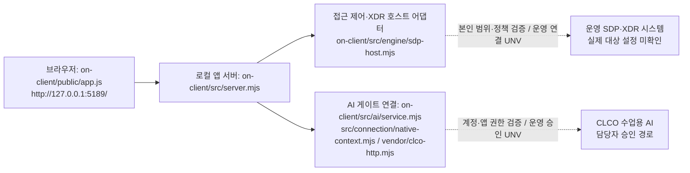

# 케셰브 학생 실행 설명서

직원이 자신의 계정·기기·세션, 업무 앱 접속 판정, 최근 보안 기록을 이해하도록 만든 로컬 앱이다. 보안 판단은 연결된 서버가 하고, 학생 화면은 이유·근거·확인 불가 상태를 표시한다. AI 설명은 참고 정보다. 이 문서는 학생 작성 문서이며 제공 문서를 대체하지 않는다.

2026-10-23 확인 기준은 `05fdc9f9755785ca39381ac4e7d8c7e32c3f7ea9`의 실행 코드다. 13~20단계는 공식 코드 원문 심사를 통과했다. 심판은 코드를 실행하지 않으며, 그 판정은 운영 연결·실제 보안 집행의 증거가 아니다. 완제품 v1.0으로 선언하지 않는다.

## 실행 위치와 지원 환경

| 구성 | 실제 확인한 환경·버전 | 범위 |
|---|---|---|
| 공식 on-client | 시작 틀0.2.14, Node.js v24.19.0 | package.json은 Node24.19.0, 외부 npm 의존성 없음. on-client에 npm install이 필요하지 않음 |
| Windows 실행 도구 | Parallels Windows11 ARM64, Windows PowerShell5.1.26100.9711 | 공식 도구로 시작·HTTP200·종료·다시 시작 확인. 실제 Windows 브라우저 조작은 이번 검사에서 미관측 |
| Mac 일반 앱 | macOS26.5.1 ARM64, Node v24.19.0 | 예제·미연결 화면, 키보드·오류·초기화 확인. Windows native 자격 기능은 Mac 지원 아님 |
| Mac 개인 ChatGPT | personal-ai, Node24.19.0, Xcode Command Line Tools | 별도 OAuth와 Keychain. 실제 모델 응답·취소·재요청 확인. 공식 ALEPH 앱 승인과 별개 |
| 소스 관리 | Git2.49.0(Mac) | Git 최상위는 저장소 루트. Windows Git 설치 여부는 미확인이며 앱 실행 자체에는 Git이 필요하지 않음 |

다른 OS·Node 버전·Windows x64·모바일 native 연동은 검증하지 않았다. Node 설치가 필요하면 [공식 배포처](https://nodejs.org/)에서24.19.0을 준비하고 새 터미널에서 버전을 확인한다. 설치 도구나 버전을 추측해 자동 설치하지 않는다.

```text
저장소 루트/                  # Git·커밋·심판 제출 위치
  on-client/                  # 공식 직원 앱: 여기서 PowerShell 실행
    package.json              # start / demo / check
    .env.example              # 비밀 없는 설정 견본; 자동으로 읽는 .env가 아님
    .on-starter-manifest.json  # 제공 시작 틀 파일 분류·기준 해시
    tools/start-alekov.ps1
    src/server.mjs
    src/engine/               # SDP 호스트 연결
    src/ai/                   # 공식 앱 AI 권한/연결
    src/actions/              # 제공 조치 처리 경계
    src/vulnerabilities/      # lock·설치 metadata와 승인 공개 패키지 조회
    public/                   # 제공 UI 기반, 앞서 적용한 디자인 포함
    student/extension.mjs     # 학생 표시 함수8개
    docs/STUDENT_RUNBOOK.md   # 이 문서
  personal-ai/                # Mac 개인 ChatGPT: 별도 npm 프로젝트
  api/, src/, public/         # 기존1~12 자료실·판정·XDR, 직원 앱과 별도 실행
  test/                     # 저장소 전체 회귀 시험
```

## Windows에서 시작·종료·다시 실행

현재 검증 PC의 앱 위치는 `$env:USERPROFILE\KeshevProject\on-client`다. 다른 사람은 실제 `on-client` 폴더를 탐색기에서 열고 주소창에 `powershell`을 입력해 새 창을 연다. 다음 명령은 기존 Windows 작업 사본의 시작 도구로 실제 확인했다. 기존 폴더·설정·자격을 삭제하지 않는다.

1. 새 PowerShell 창에서 실행 위치와 Node를 확인한다.

```powershell
Set-Location (Join-Path $env:USERPROFILE 'KeshevProject\on-client')
node --version
```

검증 PC는 portable Node를 사용했다. `node`가 없다면 그 PC에서 다음 두 줄을 먼저 실행했다. 이는 현재 PowerShell의 PATH만 바꾼다. 다른 PC에는 설치한 Node의 실제 위치를 사용한다.

```powershell
$runtime = Join-Path $env:USERPROFILE 'KeshevRuntime\node-v24.19.0-win-arm64'
$env:Path = $runtime + ';' + $env:Path
```

2. **연결을 만들지 않고 앱만 확인**하려면 실행한다. 검증 중 기존5189 앱을 보존하기 위해5197을 사용했다.

```powershell
powershell -NoProfile -ExecutionPolicy Bypass -File .\tools\start-alekov.ps1 -NoNativeHost -Port 5197 -Background
```

정상 시작 신호는 `케셰브가 켜졌습니다. 브라우저에서 http://127.0.0.1:5197/ 을 여세요.`와 `서버가 응답한 것만 확인했습니다. AI 연결 상태는 화면에서 따로 확인해 주세요.`다. 그 뒤 프로세스 번호가 나온다. 이 두 줄은 AI·SDP 연결 완료가 아니다. 브라우저에서 해당 주소를 연다. 기본 포트는5189이며 `-Port`를 생략하면 http://127.0.0.1:5189/ 이다.

3. **종료**: Background 출력에 나온 이번 실행의 node 프로세스 번호만 작업 관리자에서 종료한다. 검사에서는 해당 번호로 다음을 실행하고5197 listener가 사라진 것을 확인했다. 숫자는 실행마다 달라진다.

```powershell
 $taskPid = (Get-NetTCPConnection -LocalPort 5197 -State Listen).OwningProcess
Stop-Process -Id $taskPid
```

위 `$taskPid`는 검사에서 이번 실행 뒤 `Get-NetTCPConnection -LocalPort 5197 -State Listen`의 `OwningProcess`로 확인한 번호다. 다른 프로그램의 포트·프로세스는 종료하지 않는다. 전면 실행을 선택했다면 그 실행 창의 Ctrl+C로 종료한다(공식 안내 절차이며 이번 Windows 검사는 Background 종료를 사용).

4. **예제 모드로 다시 시작**: 같은 창·앱 폴더에서 실행한다.

```powershell
powershell -NoProfile -ExecutionPolicy Bypass -File .\tools\start-alekov.ps1 -Demo -Port 5197 -Background
```

HTTP200 및 `/api/me`의 `meta.mode=demo`를 확인했다. 예제 사용자·기기·판정은 운영 신원이 아니다. 다시 같은 방법으로 이번 node만 종료했다. 예제 실행은 native 설정을 만들지 않는다.

공식 계정 연결을 사용하는 기본 명령은 제공 [시작 안내](STUDENT_LAUNCH_GUIDE.md)의 명령을 따른다. 0.2.12 이후 도구는 Windows 개인 호스트 설정을 자동 준비하지만, 설정 준비가 계정 확인·앱 승인·AI 응답 성공을 뜻하지 않는다. 17단계에서 공식 승인 경로는 `ON_APP_NATIVE_SESSION_UNVERIFIED` / `ON_AI_PROVISIONING_PENDING` 상태였으며 운영 연결 완료로 기록하지 않았다. 이 실행 설명서 검증은 native 자격을 다시 생성·이동하지 않았다.

## Mac 실행과 개인 OAuth

일반 앱은 `on-client` 폴더에서 실제 사용한 다음 명령으로 실행한다.

```sh
node src/server.mjs --demo
```

브라우저 주소는 http://127.0.0.1:5189/ 이며 Ctrl+C로 끈다. `node src/server.mjs`의 기본 미연결 실행도 확인했다. Mac에서 공식 Windows native 자격 연결은 지원하지 않는다.

개인 ChatGPT는 저장소 루트의 `personal-ai` 폴더에서 실행한다. 아래 절차는 해당 별도 package-lock.json과 공식 SDK 복사본을 사용하며, on-client의 명령과 섞지 않는다.

```sh
npm ci
npm start
```

http://127.0.0.1:5191/ 의 AI 도우미 → 계정 및 연결 설정 → Continue with ChatGPT → OpenAI 로그인 화면 열기 순서다. 계정·앱 권한을 본인이 확인하고 승인한다. 모델 불러오기 후 직접 모델을 선택한다. 실제 응답 점검은 연결용 짧은 요청, AI 설명받기는 검토한 입력의 설명 요청이다. 예시 넣기는 자동 전송하지 않는다. 요청 취소와 Ctrl+C 종료를 확인했다. 자세한 SDK 출처·라이선스·암호화는 [개인 모드 안내](../../personal-ai/README.md)를 따른다.

## 글로 쓴 구성도와 실제 코드 경계



브라우저 → 앱 서버 → 접근 제어·XDR, 그리고 앱 서버 → AI 게이트의 네 역할을 나눈다. 브라우저는 열쇠나 접근 판정을 직접 만들지 않는다. 공식 AI 요청은 `/api/ai/explain`에 사건 ID만 보내고 서버가 본인 사건을 읽어 근거를 구성한다. 실제 대상 시스템의 비밀 주소·설정은 문서에 넣지 않았다. 실제 운영 SDP와 CLCO 상자는 **확인 안 됨/기다림(UNV)**이다. 기존 Vercel 자료실이 자동으로 이 호스트에 연결돼 있다는 뜻이 아니다.

개인 모드는 별도 흐름이다. 브라우저5191 → `personal-ai/server.mjs` → `vendor/siwc-local` → OpenAI 공개 Responses API `https://api.openai.com/v1/responses`로 사용자가 검토한 수동 입력을 전달한다. `store:false`, `stream:true`이며 완료 이벤트까지 확인한다. 자격은 프로젝트 밖 암호화 저장소와 Mac Keychain에 있고 브라우저·Git·문서에는 없다. 운영 SDP 사건 자동 수집·인용 결속을 개인 자유 입력으로 대체했다고 주장하지 않는다.

| 영역 | 책임·실제 구현 |
|---|---|
| 제공 기반 | `.on-starter-manifest.json`의 src/server·engine·ai·actions·vulnerabilities, tools, public/app.js·ai-connect·vulnerabilities-view. HTTP·인증·Origin·사용자 범위·취소·세대·응답검증 담당 |
| 학생 표시 | `student/extension.mjs`의8함수. createElement/textContent로 표시, 새 DOM 반환. 집행 POST·인증 티켓을 추가하지 않음 |
| 학생 호스트 어댑터 경계 | `student/engine-adapter.mjs`는 제공된 본인 조회 capability만 전달하는 형태 보존. 운영 연결은 미확인 |
| 이전 디자인 변경 | public/index.html·style.css와 학생 표시의 스타일 적용은 기존 사용자 요청 작업. 이번 문서 단계에서 UI·제공 서버를 변경하지 않음 |
| 개인 확장 | personal-ai의 별도 실행·OAuth·Keychain·요청 수명·UI. 공식 앱 승인으로 표시하지 않음 |

manifest는 시작 틀의 기준 해시 목록이다. 학생 수정 파일의 현재 해시가 원래 템플릿 해시와 같다는 뜻이 아니다. 20단계까지 학생 모듈 SHA-256은 `66d86b72c6c082ce378506a7b0e40f36445b7365bfa235ee319186eff232eb93`다.

| 함수·단계 | 표시하는 내용 |
|---|---|
| renderIdentity·13 | 현재 계정·기기·세션, 예제/미연결·확인 불가 |
| renderDecision·14 | allow/deny/challenge/unknown, 서버 이유·시각, 요청 실패 구분 |
| renderEvents·15 | 본인 최근 기록, 필터, 사건별 근거·규칙·상태 |
| renderStatus·16 | 기기·세션·알림, 안전한 허용 필드만 진단 복사 |
| renderAiConnection·17 | idle/loading/ok/error, test/verified, 모델 수·시각, 목록과 설명 실행 구분 |
| renderExplanation·18 | 사건과 인용 근거·규칙, unknown, 참고 요약·미실행 제안, 불일치 거부 |
| renderAction·19 | 준비·사람 확인·ACK·효과 관측, 현재 대상·영수증·중복·결과 불명 |
| renderVulnerabilities·20 | 정확한 버전·OSV 출처·시각·ID·부분 실패, 미조회/없음/조회 불가 구분 |

## 화면별 확인·실패 복구

처음에는 보호 현황 → 업무 앱 → 보안 기록 순서로 본다. 예제 앱에서 개발 저장소 접속 요청은 deny, 학습 자료실은 allow, 확인할 업무 앱은 unknown 예제다. 실제 업무 접속 성공을 의미하지 않는다. 보안 기록의 원본 기록과 AI·대응 도구를 펼치면 AI 설명 요청과 학생 설명 칸을 확인할 수 있다.

| 실제 문구·코드 | 먼저 확인할 것 → 다음 행동 |
|---|---|
| Node.js가 없습니다 / 지원 버전 안내 | 새 PowerShell에서 node --version →24.19.0 준비 후 같은 앱 폴더에서 재실행 |
| 포트가 다른 프로그램에서 사용 중 | 기존 프로그램 보존 → 도구의 -Port 5197처럼 비어 있는 포트를 사용하고 주소도 변경 |
| 연결 없음 / ENGINE_NOT_CONNECTED | 예제와 운영 모드를 구분 → 담당자에게 본인 SDP 연결 확인. 화면에서 가짜 로그인·기기값을 만들지 않음 |
| ON_AI_PROVISIONING_PENDING / native 로그인 확인 불가 | 보호 현황의 계정 연결 확인과 별도 앱 AI 승인 확인 → 담당자에게 안전한 코드·버전·시각 전달. 토큰 복사 금지 |
| WB_CLCO_AUTH_REQUIRED / ACCESS_BLOCKED | 현재 계정·앱 이용 권한 확인 → 승인 확인 또는 담당자 문의. 키를 붙여 넣어 해결하지 않음 |
| 한도·이용 시간·RATE_LIMITED | 사용량·허용 시간 확인 → 잠시 뒤 직접 점검. 자동 요청 없음 |
| ON_AI_INVALID_INPUT / INVALID_OUTPUT | 사건 근거 부족·불일치 여부 확인 → 현재 기록 다시 선택. 기존 기록·판정은 유지 |
| 조치 unknown / ACTION_TIMEOUT | 효과 없음·성공으로 단정하지 않음 → 제공 화면에서 결과만 재조회. 자동 재집행 금지 |
| 조치 expired / ACTION_CONFIRMATION_EXPIRED | 현재 사건에서 다시 준비 → 실제 대상·기한과 사람 확인. 화면 취소는 원천 효과 복구가 아님 |
| not_configured / not_checked | 대상 프로젝트 미설정/승인 공개 패키지 없음 구분 → 담당자 준비 확인. 학생이 허용 목록 확대하지 않음 |
| unverifiable / partial / 조회 실패 | lock·설치 metadata·조회 상태 확인 → 받은 ID는 유지하고 직접 재조회. none_found나 안전으로 변환하지 않음 |
| 패키지 조회 취소 | 이전 표 제거 확인 → 필요할 때 설치 패키지 조회를 직접 다시 누름. 늦은 응답은 제공 세대 비교로 폐기 |

보호 현황 → 도움정보 불러오기·지원 요청에서 도움정보를 직접 읽고 필요한 정보만 복사한다. 자동 전송하지 않는다. 계정 이메일·비밀번호·토큰·개인키·설정 원문을 문의·스크린샷·Git에 넣지 않는다.

## 검증 범위와 기다림(UNV)

| 확인 수준 | 실제 근거 |
|---|---|
| 코드 원문 심사 |13~20 공식 통과.18 57f2120 /19 2709a0d /20 05fdc9f. 서버가 실행해 확인한 결과가 아님 |
| 자동·합성 검사 |17~20 렌더 계약4시험, 개인 모드4시험. 13~16 이전 회귀도 보존. 취약점·조치 합성 입력은 실제 발견·집행이 아님 |
| Mac 실제 UI | 예제 신원·판정·기록·오류·초기화·OSV 미설정, 합성 scanner의 수동 재조회/취소/지연 폐기 |
| Windows 새 PowerShell | 최신 학생 모듈 해시 대조, 기본 NoNativeHost 및 Demo를5197에서 시작·HTTP200·종료·재시작. 브라우저 직접 관측은 미확인 |
| 개인 OAuth 실제 | 새 앱 승인 후 계정 모델7개·gpt-6-luna 가상 기록 설명·취소·재요청 확인. 운영 SDP 사건은 보내지 않음 |
| 기다림(UNV) | 운영 SDP 신원/본인 사건 전달, 공식 native 계정·AI 승인, 실제 학생 조치 집행·원천 효과·재조회, 승인된 실제 OSV 외부 조회, 다른 환경 지원 |

저장소 루트의 검증 명령:

```sh
node --test test/on-client-stage17.test.mjs test/on-client-stage18.test.mjs test/on-client-stage19.test.mjs test/on-client-stage20.test.mjs
```

개인 모드는 별도로 `personal-ai`에서 `npm test`다. 실행하지 않은 인증·조치·외부 조회를 시험 통과로 쓰지 않는다.

## 커밋·제출

Git 최상위 저장소에서 변경을 확인·커밋한다. 현재 공개 저장소는 `https://github.com/SKT-ALEPH/choi-bujang-secret-vault`이며 포털은 `https://aleph-omega.vercel.app/defense`다.21·22는 현재 안내상 워크벤치의13~20 제출 준비와 달리 과제 화면에 저장소와40자리 커밋을 직접 입력한다. 공개 커밋은 원격에 올라가 있어야 한다. 비공개 저장소를 공개로 바꾸지 않는다.

비공개 커밋은 해당 단계의 원문 준비 방법에서 받은 도구를 프로젝트 밖에 풀고, Git 최상위에서 출력 JSON도 프로젝트 밖 새 폴더에 만든다. 안내된 CLI에 실제 --commit40자리 값을 지정하고 같은 단계의 비공개 원문 입력으로 선택한다. 도구는 커밋 원문만 묶고 코드를 실행하거나 자동 업로드하지 않는다. 원문 전달과 심사 통과는 다르다. 원문 전달만 실패하면 기존 접수를 유지하고 원문만 다시 보내기를 사용한다. 이 프로젝트는 공개 커밋 직접 제출을 사용해 이 비공개 CLI 실행은 미확인이다.
