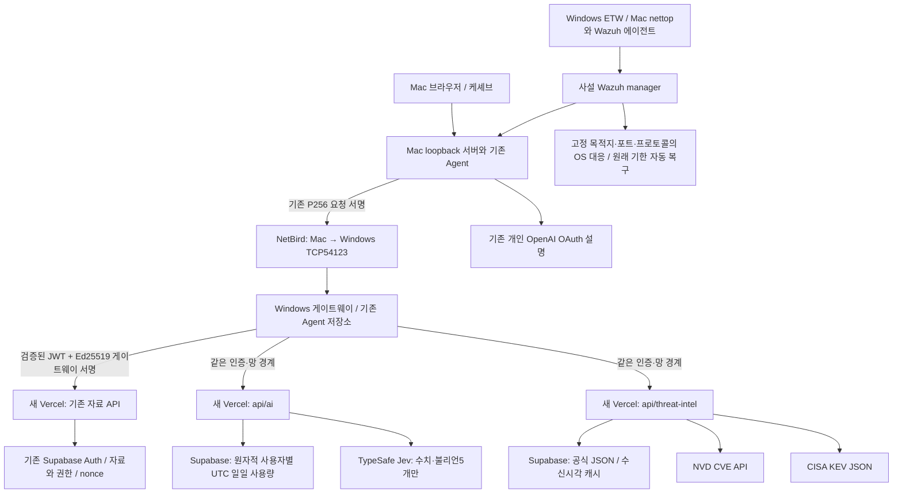

# 구성도와 신뢰 경계

그림은 현재 구현의 역할과 경로다. [SELF-CHECK](SELF-CHECK.md)에서 각 실제 연결의 검증 여부를 구분한다. 그림이 있다는 이유로 연동 완료로 판정하지 않는다.

## 인증과 권한

`public/device-client.mjs`의 기존 기기 증명과 Supabase Auth 세션은 Mac→Windows→새 Vercel의 기존 자료 API로 전달된다. Windows는 서명을 추가하지만 원래 사용자로 가장하는 헤더를 만들지 않는다. `src/verify-login.mjs`와 judgeIssuer는 보존했다. 서버 자료 API가 검증된 userId와 DB의 owner_id/편집권한을 비교한다. 브라우저 버튼 숨김은 권한 판정이 아니다.

`src/netbird-gateway.mjs`는 메서드·경로·본문·기기 증명·시각·nonce가 결속된 Windows 서명과 서비스 전용 nonce 저장소를 확인한다. `on-client/student/netbird-vault.mjs`는 현재 사용자 세션/Agent 권한과 XDR 거부를 확인한 뒤 고정 API만 호출한다. `packageServicesUrl`은 두 패키지 경로에만 쓰는 HTTPS Vercel origin이다. 임의 URL 프록시는 없다. 제출본은 `publicAppUrl`과 `packageServicesUrl`을 같은 새 origin으로 맞춰 로그인·자료·패키지 API를 같은 배포에서 처리한다. 기존 Supabase 계정·자료와 등록된 게이트웨이 키를 재사용하며 기존 프로젝트와 새 프로젝트 모두 같은 main 코드를 배포하며 계정·자료·접근 정책을 보존한다.

`src/package-services.mjs`는 두 패키지 API에서 원본 JWT 검증·XDR 거부·게이트웨이 서명을 재사용한다. `api/ai.js`는 본문에 userId를 받지 않고 확인된 ID만 한도 키로 쓴다. SQL의 UTC 일자/원자적 예약이 서버 재시작·동시 호출·브라우저 새로고침의 한도 우회를 막는다. 상류 전송을 시도한 실패도 예약한 횟수에 남긴다. 알려진 서버 키 미설정은 전송·예약 전에503으로 거부한다. `api/threat-intel.js`는 고정 구성요소와0~39페이지 외 쿼리를 거부한다.

## AI 두 연결

개인 OpenAI OAuth는 로컬 AI 설명이며 서버 Jev 키와 다르다. OAuth 토큰·API 키는 브라우저 번들·Git에 넣지 않는다. Jev 요청은 `level/failureCount/accountCount/multiAccount/samePassword`만 보낸다. 결과는 모델 확신도와 설명이며 자료 허용·거부 또는 OS 차단 명령이 아니다. 테스트용 고정 수치를 실제 사건 관측이라고 표현하지 않는다.

## PC 감시와 대응

PC 센서→사설 manager→고정 active response가 OS 차단을 집행한다. 미승인 목적지에120초 내5회 이상·50MB 이상 송신이 기준이고,15분 기한을 재시작해도 보존한다. 브라우저와 AI가 차단 규칙을 작성하지 않는다. 신선한 승인 DNS/IP의443 예외는 내용 검사나 전체 DLP가 아니다. Mac 표본·기존 연결 강제 종료 한계와 실제 근거는 [PC 검증](../docs/PC_SECURITY_VERIFICATION.md)을 따른다.

## 서버 함수 기준

`package/baseline-functions.json`은 실제12단계 커밋 `27e6474bed35c53b70e02bc52bec816659b36f7d`의 기존7개 API를 Git 트리로 확인한다. 신규 허용 함수는 `api/ai.js`, `api/threat-intel.js`뿐이다. 재사용 helper는 `src/`에 있으며 새 공개 함수가 아니다. 기존 메모·Auth·기기 API는 교체하지 않는다.
